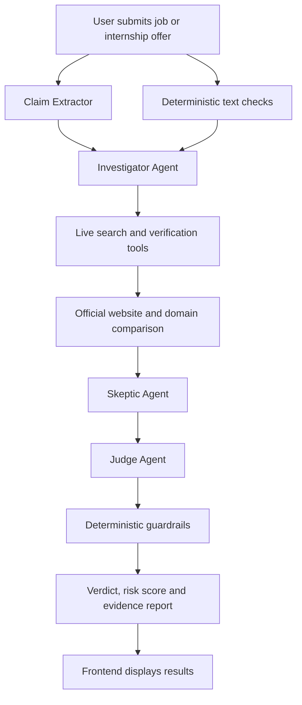
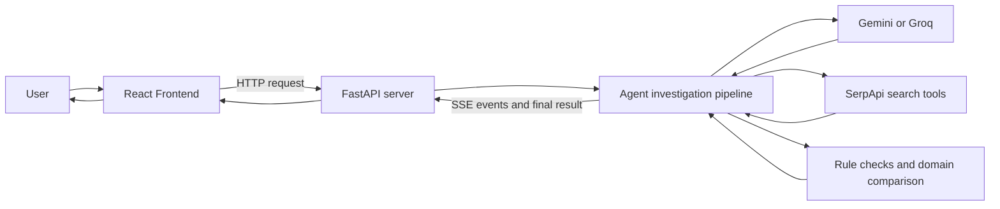

# Agentic AI Based Fake Job & Internship Verification System

**Application name:** HireGuard AI  
**Tagline:** Verify Opportunities. Protect Your Career.

HireGuard AI is an Agentic AI-based platform designed to help students, fresh graduates and job seekers assess the credibility of job offers and internship opportunities. It uses a multi-agent investigation workflow, live web search, deterministic scam indicators and evidence-based reporting to identify warning signs and provide a reasoned assessment.

> **Project status:** This project is based on an existing working multi-agent job-offer investigation application. The current verification workflow is the implemented core. The Career Assistance features described in the roadmap are proposed Phase 2 enhancements and are not implemented in the current version.

---

## Table of Contents

1. [Problem Statement](#1-problem-statement)
2. [Project Objectives](#2-project-objectives)
3. [Key Features](#3-key-features)
4. [How the System Works](#4-how-the-system-works)
5. [Multi-Agent Architecture](#5-multi-agent-architecture)
6. [Technology Stack](#6-technology-stack)
7. [System Architecture](#7-system-architecture)
8. [Project Structure](#8-project-structure)
9. [Prerequisites](#9-prerequisites)
10. [Installation and Setup](#10-installation-and-setup)
11. [Environment Configuration](#11-environment-configuration)
12. [Running the Application](#12-running-the-application)
13. [Using the Application](#13-using-the-application)
14. [API Endpoints](#14-api-endpoints)
15. [Risk Assessment and Guardrails](#15-risk-assessment-and-guardrails)
16. [Search Caching and Budget](#16-search-caching-and-budget)
17. [Sample Test Cases](#17-sample-test-cases)
18. [Phase 2: Planned Career Assistance Features](#18-phase-2-planned-career-assistance-features)
19. [Security and Responsible Use](#19-security-and-responsible-use)
20. [Current Limitations](#20-current-limitations)
21. [Future Enhancements](#21-future-enhancements)
22. [Troubleshooting](#22-troubleshooting)
23. [Acknowledgement](#23-acknowledgement)

---

## 1. Problem Statement

Students and fresh graduates regularly search for internships, fresher jobs and entry-level opportunities through job portals, email, messaging applications and social media. Fraudulent recruiters may impersonate established companies, advertise unrealistic salaries or stipends, request registration or training fees, collect personal information, or pressure candidates to respond quickly.

A message can look professional and still be fraudulent. Conversely, a genuine opportunity from a small or newly established company may have limited information available online. A simple text classifier or an LLM opinion is therefore not enough to establish whether an opportunity is trustworthy.

The system addresses this problem by extracting claims from a job offer and checking those claims against available live search evidence. Multiple AI agents investigate and challenge the evidence before a final structured assessment is produced.

## 2. Project Objectives

- Help students and job seekers assess suspicious job and internship offers before responding or making payments.
- Extract important information such as company name, job role, recruiter details, sender email, website, location, salary or stipend and requested payments.
- Investigate company and recruitment claims using live search results.
- Identify warning signs such as payment requests, urgency tactics, unofficial email domains and movement to messaging groups.
- Compare the sender's email domain with the company's official website domain identified during the investigation.
- Provide a transparent risk score, verdict, evidence ledger, red flags and positive indicators.
- Suggest practical next steps, including contacting the company through an official channel.

## 3. Key Features

### 3.1 Job and internship offer submission

Users can submit the text of a job or internship offer and optionally provide the sender's email address. The frontend also provides sample genuine and scam messages for testing.

### 3.2 Multi-agent investigation

Four agents perform different responsibilities: claim extraction, investigation, skeptical evidence review and final judgement.

### 3.3 Live web research

The investigation can use SerpApi search integrations to gather information from Google Search, Google News, Google Maps, YouTube and Google Jobs.

### 3.4 Deterministic scam-indicator checks

In addition to LLM reasoning, the backend scans offer text for known indicators such as payment requests, UPI references, urgency, limited seats, vague compensation and WhatsApp or Telegram recruitment groups.

### 3.5 Evidence-based verdict

The system returns one of four verdicts:

- `LIKELY_SCAM`
- `SUSPICIOUS`
- `NOT_ENOUGH_EVIDENCE`
- `LIKELY_LEGIT`

The report includes a 0–100 risk score, claim-by-claim evidence, red flags, green flags, official website or contact information when found, a suggested verification email and recommended next steps.

### 3.6 Live investigation progress

The FastAPI backend streams investigation events using Server-Sent Events (SSE), allowing the frontend to display agent activity and search progress while the investigation is running.

### 3.7 Search cache and usage budget

Search results are cached locally and each investigation has a configurable maximum number of live searches. Repeated searches can use cached results instead of consuming additional SerpApi searches.

## 4. How the System Works

The user submits an offer and, if available, the sender's email address. The backend extracts claims, runs deterministic checks and sends the case information through the agent workflow.



The result is an assessment based on the evidence found during the investigation. It is not a legal certification or an absolute guarantee that an opportunity is genuine or fraudulent.

## 5. Multi-Agent Architecture

The current implementation contains four agents.

| Agent | Responsibility | Output / contribution |
|---|---|---|
| **1. Claim Extractor** | Reads the offer and extracts structured information such as company, role, recruiter, sender email, phone or WhatsApp details, office address, website, compensation and requested money. | Structured claims that can be checked independently. |
| **2. Investigator** | Uses search tools to investigate the company, role, recruiter, location and other claims in the offer. | Search findings, possible official website and supporting or contradictory information. |
| **3. Skeptic** | Looks for evidence that the offer may be legitimate and challenges the initial concerns. | Counter-evidence and a check against premature conclusions. |
| **4. Judge** | Weighs the extracted claims, search evidence, red flags and counter-evidence. | Structured verdict, risk score, claim checks, email draft and next steps. |

### 5.1 Deterministic checks

The backend also runs code-based checks on the submitted text. These checks do not depend entirely on the LLM and include patterns related to:

- Registration, processing, training, laptop, kit, onboarding or verification fees and deposits.
- Payment amounts, UPI IDs and requests to pay.
- Gift cards, cryptocurrency and similar payment methods.
- Short deadlines, urgency and limited-seat pressure.
- WhatsApp or Telegram links and requests to move recruitment into chat groups.
- Vague compensation statements such as “up to” a stated amount or performance-based pay.
- Generic greetings such as “Dear Candidate”.

### 5.2 Domain comparison

The system compares the sender email domain with the official website domain discovered during the investigation. This can help identify free email providers and lookalike domains. A domain match alone does not prove that an offer is genuine.

## 6. Technology Stack

| Layer | Technology | Purpose |
|---|---|---|
| Frontend | React 18 | User interface and result presentation |
| Frontend tooling | Vite | Development server and production build |
| UI animation | Framer Motion | Interface transitions and animations |
| Backend | Python and FastAPI | API and investigation orchestration |
| ASGI server | Uvicorn | Runs the FastAPI application |
| Agent framework | LangChain | LLM-powered agent workflows and tools |
| LLM providers | Google Gemini or Groq | Claim extraction, agent reasoning and structured verdicts |
| Search integration | SerpApi and `serpapi-search-tools` | Live search evidence |
| Configuration | python-dotenv | Loads environment variables from `.env` |
| Data validation | Pydantic | Validates investigation request and structured agent outputs |

## 7. System Architecture

The application has two main parts:

1. **React frontend:** collects the offer, starts an investigation, displays live progress and renders the final report.
2. **FastAPI and Python backend:** validates the request, runs the agent pipeline, invokes search tools, applies guardrails and streams events to the frontend.



### Search engines used

| Search source | Purpose |
|---|---|
| Google Search | Find the official company website, careers page and company statements. |
| Google News | Find relevant news and reports about possible recruitment scams. |
| Google Maps | Investigate whether a stated office or business location has supporting information. |
| YouTube | Search for relevant videos or scam warnings. |
| Google Jobs | Check whether a role is publicly listed. |

Search availability and result quality depend on the SerpApi account, query and information indexed by the relevant service.

## 8. Project Structure

The main project structure is:

```text
project-root/
├── frontend/
│   ├── public/
│   │   └── favicon.svg
│   ├── src/
│   │   ├── components/
│   │   │   ├── Actions.jsx
│   │   │   ├── Brand.jsx
│   │   │   ├── Evidence.jsx
│   │   │   ├── Hero.jsx
│   │   │   ├── Icons.jsx
│   │   │   ├── Investigation.jsx
│   │   │   ├── OfferForm.jsx
│   │   │   ├── SerpPanel.jsx
│   │   │   └── Verdict.jsx
│   │   ├── lib/
│   │   │   ├── format.js
│   │   │   ├── motion.js
│   │   │   └── useInvestigation.js
│   │   ├── App.jsx
│   │   ├── main.jsx
│   │   └── styles.css
│   ├── index.html
│   ├── package.json
│   └── vite.config.js
├── samples/
│   ├── README.md
│   ├── genuine_offer.txt
│   └── scam_impersonation.txt
├── touchstone/
│   ├── __init__.py
│   ├── llm.py
│   ├── pipeline.py
│   ├── prompts.py
│   ├── schemas.py
│   ├── serp_client.py
│   └── tools.py
├── .env.example
├── .gitignore
├── cli.py
├── README.md
├── render.yaml
├── requirements.txt
└── server.py
```

**Important:** The original Python package and some internal filenames may still contain the name `touchstone`. They are implementation files from the base project. Do not rename them unless imports and deployment configuration are updated and tested accordingly. The visible application brand can be HireGuard AI independently of internal module names.

## 9. Prerequisites

Install the following software:

- Python 3.12 (the deployment configuration specifies Python 3.12.7; the source README states Python 3.10 or later).
- Node.js and npm for frontend development.
- Visual Studio Code or another code editor.
- Git (recommended for version control).
- A SerpApi API key.
- A Google Gemini API key or a Groq API key.

Useful downloads:

- Python: https://www.python.org/downloads/
- Node.js: https://nodejs.org/en/download
- VS Code: https://code.visualstudio.com/
- Git: https://git-scm.com/downloads
- SerpApi: https://serpapi.com/
- Google AI Studio: https://aistudio.google.com/apikey
- Groq: https://console.groq.com/keys

## 10. Installation and Setup

The following commands are for Windows PowerShell. Run them from the project root directory.

### Step 1: Create a virtual environment

```powershell
python -m venv .venv
```

### Step 2: Activate the virtual environment

```powershell
.venv\Scripts\Activate.ps1
```

If PowerShell blocks activation, you can use a Command Prompt terminal and run:

```cmd
.venv\Scripts\activate.bat
```

### Step 3: Upgrade pip

```powershell
python -m pip install --upgrade pip
```

### Step 4: Install Python dependencies

```powershell
pip install -r requirements.txt
```

### Step 5: Install frontend dependencies

```powershell
cd frontend
npm install
cd ..
```

### Step 6: Create the environment file

Copy `.env.example` to `.env` in the project root and add your own API keys. See [Environment Configuration](#11-environment-configuration).

**Never commit or share your `.env` file.**

## 11. Environment Configuration

Create a `.env` file in the root directory:

```env
SERPAPI_API_KEY=your_serpapi_api_key

LLM_PROVIDER=gemini
GOOGLE_API_KEY=your_google_ai_studio_api_key
GEMINI_MODEL=gemini-3.5-flash-lite

# Optional Groq provider configuration
# GROQ_API_KEY=your_groq_api_key
# GROQ_MODEL=openai/gpt-oss-120b
```

### Required keys

| Variable | Required? | Description |
|---|---|---|
| `SERPAPI_API_KEY` | Yes | Enables live search through SerpApi. |
| `LLM_PROVIDER` | Yes | Selects `gemini` or `groq`; defaults to `gemini`. |
| `GOOGLE_API_KEY` | Required for Gemini | Google AI Studio API key. `GEMINI_API_KEY` is also accepted by the backend. |
| `GEMINI_MODEL` | For Gemini | Model name; the source default is `gemini-3.5-flash-lite`. |
| `GROQ_API_KEY` | Required for Groq | Groq API key when `LLM_PROVIDER=groq`. |
| `GROQ_MODEL` | For Groq | Model name; the source default is `openai/gpt-oss-120b`. |

### Optional configuration

The backend also supports these optional environment variables:

| Variable | Default in source | Purpose |
|---|---:|---|
| `TOUCHSTONE_LLM_RPM` | `10` | Shared LLM request rate limiter target per minute. |
| `TOUCHSTONE_MAX_RESULT_CHARS` | Provider-dependent | Maximum search-result text passed to the LLM. |
| `TOUCHSTONE_CACHE_DIR` | `.serp_cache` | Directory used for cached SerpApi results. |
| `TOUCHSTONE_PUBLIC` | `0` | Enables public deployment quota controls when set to `1`. |
| `TOUCHSTONE_MAX_BUDGET` | `16` | Maximum live search budget accepted by the server configuration. |
| `TOUCHSTONE_DAILY_LIMIT` | `3` | Per-IP daily investigation limit in public mode. |

The investigation request defaults to a search budget of 12 and validates a budget between 4 and 16. The server may apply a lower maximum when configured for public use.

## 12. Running the Application

Run the backend and frontend in two separate terminals.

### Terminal 1: Start the FastAPI backend

From the project root, activate the virtual environment and run:

```powershell
.venv\Scripts\Activate.ps1
uvicorn server:app --reload
```

The backend will be available at:

- API base URL: http://localhost:8000
- Configuration check: http://localhost:8000/api/config

### Terminal 2: Start the React frontend

```powershell
cd frontend
npm run dev
```

Vite normally displays the frontend URL:

http://localhost:5173

Open the URL printed in the terminal. The Vite configuration proxies `/api` requests to the backend on port `8000` during development.

### Production frontend build

To create an optimized frontend build:

```powershell
cd frontend
npm run build
```

The generated files are placed in `frontend/dist`. The FastAPI application serves the built frontend from that directory. Rebuild after frontend changes so the production-served files are updated.

To preview the production build locally:

```powershell
npm run preview
```

## 13. Using the Application

1. Open the HireGuard AI application in your browser.
2. Paste the job or internship offer text into the offer submission area.
3. Provide the sender's email address if it is not already included in the offer.
4. Select a search budget if the interface provides that option.
5. Start the investigation.
6. Follow the live agent activity and search progress.
7. Review the final verdict and risk score.
8. Read the evidence ledger and check the linked sources.
9. Review red flags, green flags and the suggested next steps.
10. If available, use the suggested verification email to contact the company through a contact channel independently confirmed from an official source.

Do not pay a fee or share sensitive personal information merely because the system returns `LIKELY_LEGIT`. Independently verify important details with the company.

## 14. API Endpoints

The current FastAPI backend exposes the following endpoints:

| Method | Endpoint | Purpose |
|---|---|---|
| `GET` | `/api/config` | Returns configuration information such as provider, public-mode settings, search budget limits and whether required keys are present. |
| `GET` | `/api/samples/{name}` | Returns a sample offer. Supported names in the current server are `genuine` and `scam`. |
| `GET` | `/api/credits` | Attempts to retrieve the remaining SerpApi searches for the configured account. |
| `POST` | `/api/investigate` | Starts an investigation and streams events using Server-Sent Events. |

### Investigation request

The `POST /api/investigate` request accepts a JSON body with these fields:

```json
{
  "offer": "Paste the job or internship offer text here. It must contain at least 20 characters.",
  "sender": "recruiter@example.com",
  "budget": 12
}
```

- `offer`: Required string, minimum 20 and maximum 8,000 characters.
- `sender`: Optional sender email string, maximum 200 characters.
- `budget`: Search budget, default 12, minimum 4 and maximum 16.

The response uses `text/event-stream`. The frontend should consume the streamed events and update the investigation view as events arrive. The stream ends with a `done` event.

### Interactive API documentation

The source configures FastAPI with its built-in Swagger and ReDoc documentation disabled. The endpoints can be tested using an HTTP client such as Postman or an appropriate frontend/API test tool.

## 15. Risk Assessment and Guardrails

The system combines LLM-generated analysis with deterministic rules. The source applies guardrails after the Judge agent produces a verdict.

Examples of guardrail behavior include:

- An offer requesting money from a non-official email domain is not allowed to remain `LIKELY_LEGIT` or `NOT_ENOUGH_EVIDENCE`; it is raised to at least `SUSPICIOUS`.
- Recruitment moved into a chat group, or multiple pressure signals from an unverified sender, can raise the result to `SUSPICIOUS`.
- `LIKELY_LEGIT` requires the offer to come from the company's official email domain according to the domain check.
- The risk score is constrained to a range consistent with the verdict.

The score ranges described in the current source README are:

| Verdict | Risk score range |
|---|---:|
| `LIKELY_LEGIT` | 0–30 |
| `NOT_ENOUGH_EVIDENCE` | 30–60 |
| `SUSPICIOUS` | 45–74 |
| `LIKELY_SCAM` | 75–100 |

Some ranges overlap by design. The score is a risk indicator produced by the system, not a statistically calibrated probability of fraud.

## 16. Search Caching and Budget

The custom `CachedBudgetClient` in `touchstone/serp_client.py` provides:

- **Disk cache:** stores search results to avoid repeating identical live searches.
- **Per-investigation budget:** limits the number of live searches for an investigation.
- **Search log:** records the engine, query and status for the frontend investigation trace.
- **Graceful failure handling:** returns a readable note when a search fails rather than allowing a search exception to crash the workflow.
- **Result trimming:** reduces the amount of search-result text passed to the LLM while retaining the cached result.

The cache directory defaults to `.serp_cache`. Cached results may be reused on subsequent investigations. Search budget and cache behavior help control API usage, but they do not guarantee that every investigation will use the same number of live searches.

## 17. Sample Test Cases

The `samples/` directory contains two synthetic test messages:

| File | Purpose |
|---|---|
| `genuine_offer.txt` | Example of a legitimate-style offer with an official-domain sender and no payment request. |
| `scam_impersonation.txt` | Example of a scam-style offer involving impersonation, a free email sender, a refundable UPI deposit and a short deadline. |

These examples are synthetic test data. They were not sent by the companies named in the messages. They are provided to test the workflow and should not be treated as evidence about a real company.

### Command-line testing

The project also includes `cli.py` for running an investigation from a local text file:

```powershell
python cli.py samples/scam_impersonation.txt --budget 10
```

To supply a sender email separately:

```powershell
python cli.py my_offer.txt hr@example.com --budget 10
```

## 18. Phase 2: Planned Career Assistance Features

The following features are proposed future enhancements. They are **not part of the current implemented verification workflow**. In the current frontend phase, they may be shown as preview cards with a clear **Coming Soon – Next Phase** label.

The proposed Career Assistance section is intended to appear as a general homepage preview. A contextual preview may also be shown after an assessment returns `LIKELY_LEGIT`, with a clear explanation that this is an AI assessment and not a guarantee of authenticity.

### 18.1 AI Preparation Module

A future preparation assistant that can create a role-oriented study plan, identify important technical subjects, suggest aptitude topics and organize learning resources.

### 18.2 Company Exam Pattern

A future feature to present recruitment stages such as aptitude tests, technical assessments, coding rounds and interviews when reliable information is available.

### 18.3 AI Interview Preparation

A future feature to help candidates prepare technical and HR interview questions based on the job role and verified company-specific information.

### 18.4 CTC and Salary Insights

A future feature to explain advertised CTC, stipend, compensation structure and benefits. Figures must be sourced from the job posting or reliable references and clearly labelled when estimated.

### 18.5 Company Insights

A future company profile containing business overview, industry, official website, office locations and other relevant information supported by reliable sources.

### 18.6 Skill Development Roadmap

A future feature to identify skills required for a role and recommend a structured learning path.

**Phase 2 implementation note:** These previews should not display fabricated salary figures, exam patterns, interview questions or company details. Their actual functionality will be implemented in a later development phase.

## 19. Security and Responsible Use

- Keep API keys in `.env` and never commit them to a public repository.
- Treat job-offer text, search results, links and external pages as untrusted input.
- Review the source links in the evidence ledger rather than relying only on the generated summary.
- Verify the company using contact details obtained independently from its official website.
- Do not make payments or share identity documents based only on an AI result.
- A `NOT_ENOUGH_EVIDENCE` result means that the system could not establish sufficient evidence; it does not mean the offer is safe.
- Small, new or local companies may have a limited online presence. Avoid treating a lack of search results as proof of fraud.
- Public deployments should enable the built-in quota controls and use appropriate hosting, monitoring and abuse protection.
- The sample offers are synthetic and should only be used for testing.

## 20. Current Limitations

- New, small or lesser-known companies may have limited online information, leading to `NOT_ENOUGH_EVIDENCE`.
- Search results can be incomplete, outdated or inaccurate.
- LLM providers may apply rate limits or experience temporary service failures.
- A search result or domain match cannot independently prove that a recruiter or offer is genuine.
- The current project does not configure a persistent application database or user authentication system.
- Career preparation, company exam patterns, interview assistance, CTC insights and skill roadmaps are planned Phase 2 features, not currently implemented functionality.
- The system is an assistance tool and should not replace independent verification or professional judgement.

## 21. Future Enhancements

Planned development directions include:

- Implement the Phase 2 Career Assistance features described above.
- Add user accounts and a secure history of previous investigations.
- Add a persistent database for saved reports and user preferences.
- Add more regional-language support.
- Explore reverse-image checks for recruiter profile photos, subject to privacy and source reliability.
- Explore a browser extension for reviewing job offers on supported websites and messaging interfaces.
- Improve source quality assessment and explainability.
- Add automated tests for API endpoints, agent outputs and frontend workflows.

These are future development ideas and should not be represented as completed features until implemented and tested.

## 22. Troubleshooting

### Problem: `pip install -r requirements.txt` cannot find a package

First upgrade pip inside the activated virtual environment:

```powershell
python -m pip install --upgrade pip
```

Then retry:

```powershell
pip install -r requirements.txt
```

If installation still fails, check the exact package name, Python version, network connection and configured package index. Do not remove a dependency from `requirements.txt` without checking whether the source code uses it.

### Problem: Backend says API keys are missing

- Confirm `.env` is in the project root, alongside `server.py`.
- Confirm the variable names are spelled correctly.
- Confirm there are no placeholder values left.
- Restart Uvicorn after changing `.env`.
- Check `http://localhost:8000/api/config` to see whether the backend reports that its required keys are present.

### Problem: Frontend cannot connect to the backend

- Confirm the backend is running at `http://localhost:8000`.
- Confirm the frontend is running through Vite.
- Check `frontend/vite.config.js` and preserve its `/api` proxy configuration.
- Inspect the browser developer console and backend terminal for errors.

### Problem: Frontend changes do not appear in the production-served application

Run a fresh build:

```powershell
cd frontend
npm run build
```

The FastAPI server serves the generated files from `frontend/dist`.

### Problem: LLM rate limit or provider error

- Check the selected provider and API key.
- Wait for the provider's rate limit window to reset.
- Consider switching between Gemini and Groq by updating `LLM_PROVIDER` and configuring the corresponding API key.
- Restart the backend after changing environment variables.

### Problem: Search returns no evidence

Check the SerpApi key, remaining account searches, query relevance and network connectivity. A lack of search results should be reported as insufficient evidence rather than automatically treated as proof of fraud.

## 23. Acknowledgement

This project uses an existing open-source multi-agent job and internship offer investigation codebase as its technical starting point. The HireGuard AI project identity, academic project framing and planned Career Assistance roadmap are the intended project-level adaptations.

Retain and comply with the original repository's license and attribution requirements when redistributing or publishing modified source code. Review the original repository and its license file before public release.


